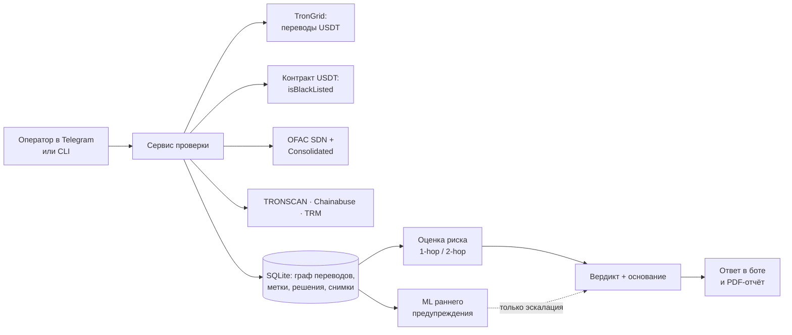

# AML-скрининг USDT (TRON)

> TRON/USDT (TRC-20) wallet risk screening for crypto exchanges, P2P and OTC desks: sanctions, Tether freezes, 2-hop exposure, analyst governance and a PDF report. **Showcase repository — source code is private and shown on request.**

Telegram-бот и консольный инструмент, который проверяет USDT-кошелёк в сети TRON **до того, как обменник примет с него деньги**. На выходе — не просто число, а однозначный вердикт с основанием, которое можно показать комплаенсу.

Целевые пользователи — обменники, P2P-площадки и OTC-столы в Центральной Азии.

---

## Что получает оператор

Каждая проверка заканчивается одним из пяти вердиктов:

| Вердикт | Когда | Что делать |
|---|---|---|
| **ОТКАЗАТЬ** | заморозка Tether, санкционный листинг, предписание | не принимать средства |
| **РУЧНОЙ РАЗБОР** | высокий риск или санкционная экспозиция | задержать до решения офицера |
| **ПРИНЯТЬ С НАБЛЮДЕНИЕМ** | средний риск | принять, пометив клиента |
| **ПРИНЯТЬ** | низкий риск и данных проверено достаточно | принять в обычном порядке |
| **НЕДОСТАТОЧНО ДАННЫХ** | проверено слишком мало | по отчёту решение принимать нельзя |

«Принять» и «недостаточно данных» намеренно разделены: «ничего не нашли» и «толком не проверили» — разные ответы, и система никогда не выдаёт второе за первое.

К вердикту прилагается **PDF-отчёт** (`/pdf <адрес>` в боте или из командной строки) — документ для дела клиента.

## Что проверяется

**Санкции и заморозки**
- OFAC: списки SDN и Consolidated, автообновление раз в сутки с защитой от «обрезанной» выгрузки
- текущий чёрный список Tether — прямо из смарт-контракта USDT (`isBlackListed`)
- история заморозок Tether, импорт OpenSanctions

**Связи кошелька**
- прямые (1-hop) и через одного посредника (2-hop) контрагенты и доля средств, прошедших через рискованные адреса
- атрибуция бирж и сервисов, роль кошелька (биржа, транзит, конечный пользователь), разбивка потоков
- фильтр транзитных хабов и защита от «отравленных» сумм — чтобы одна аномальная транзакция не искажала оценку

**Дополнительные источники** (подключаются ключами API): TRONSCAN, Chainabuse, TRM Labs.

## Контроль решений аналитика

- **Очередь ручного разбора** для спорных адресов
- **Правило двух человек:** исключение («ложное срабатывание») вступает в силу, только когда его утвердил второй аналитик — автор запроса не может утвердить сам себя
- Решение аналитика **не может снять** санкционный листинг или заморозку Tether; попытка записывается в основание отчёта для аудита
- Лимит исключений на одного аналитика за 30 дней, снимки каждой проверки для аудита, ретеншен данных по срокам

## ML-слой раннего предупреждения

Отдельный от основной оценки модуль, который ищет кошельки, похожие на будущие замороженные — **до** заморозки.

- 84 поведенческих признака только из истории, доступной на момент оценки: объёмы, скорость, концентрация контрагентов, «быстрый вывод после поступления», ритм активности
- хронологическое разбиение train / calibration / test, без пересечения адресов между частями
- ансамбль HistGradientBoosting + RandomForest + Logistic Regression с калибровкой
- **модель работает в теневом режиме**, пока на отложенной выборке не покажет recall ≥ 50%, FPR ≤ 5% и ROC-AUC ≥ 0,70 при ≥ 100 положительных примерах
- даже одобренная модель может только отправить адрес на ручной разбор — **она никогда не меняет основную оценку риска**

## Архитектура

## Техническая сторона

| | |
|---|---|
| Язык и стек | Python 3, асинхронный `httpx`, SQLite, scikit-learn, ReportLab |
| Объём | 99 файлов Python, около 20 000 строк |
| Тесты | 368 автотестов: регрессии по каждой версии, проверка, что в ML не попадают «будущие» данные, правило двух человек, формат PDF |
| Релизы | Перед каждым выпуском — отдельная проверка результата по чек-листу, а не только «тесты зелёные» |
| Развитие | Итеративно, от версии 3.2 до 5.8; по обратной связи от обменников добавлены однозначный вердикт и PDF-отчёт |

## Чего система не утверждает

- Не говорит «кошелёк чистый». Максимум — «нет известной негативной информации».
- Не заявляет точность ML без измерения на отложенной выборке.
- Не заменяет регулируемого провайдера там, где он обязателен по закону.

## Как сделан

Проект спроектирован и собран мной. Код писался итеративно вместе с AI-ассистентом (Claude): я ставил задачи, проверял результат на реальных кошельках и выявлял ошибки, ассистент помогал с реализацией. Я понимаю архитектуру и логику каждой проверки и могу разобрать любой модуль на собеседовании.

## Код

Проект коммерческий, поэтому исходный код в закрытом доступе. Покажу код и живую проверку адреса на созвоне.

**Улугбек Маткаримов** · [LinkedIn](https://www.linkedin.com/in/ulugbek-matkarimov-304a6b230) · Telegram [@luciuverus](https://t.me/luciuverus)
